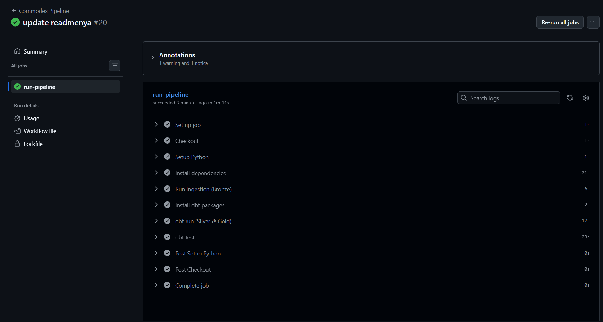

<div align="center">
  
  
</div>

<div align="center">

[](https://github.com/dimssrmdn01/commodex/actions/workflows/pipeline.yml)


</div>

## About The Project

**Commodex** adalah pipeline *end-to-end analytics engineering* yang menerapkan **Medallion Architecture** (Bronze → Silver → Gold). Data harga aset diambil dari [CoinGecko API](https://www.coingecko.com/en/api), dibersihkan dan dimodelkan dengan dbt, divalidasi dengan data quality test, lalu disimpan di PostgreSQL cloud (Neon). Seluruh alurnya berjalan otomatis lewat GitHub Actions.

**Key highlights:**
- **Layered by design.** Bronze menyimpan data mentah apa adanya, Silver membersihkan dan mendeduplikasi, Gold menyajikan agregasi siap analisis.
- **Tested, not assumed.** 7 tes dbt (`not_null`, `accepted_values`, `unique_combination_of_columns`) dijalankan di setiap eksekusi.
- **Persistent history.** Setiap run menambah snapshot baru ke Neon, sehingga histori harga terakumulasi dari hari ke hari.
- **Fail-fast CI.** Jika ingestion gagal, pipeline langsung berhenti dan workflow berstatus merah.
- **Secure by default.** Kredensial database dibaca dari GitHub Secrets dan environment variable, tidak pernah di-commit.
- **Reproducible.** Satu `docker compose up` untuk database lokal, versi dbt dikunci di `requirements.txt`.

**Aset yang dilacak:** Bitcoin, Ethereum, Tether, Solana, BNB (harga IDR dan USD).

## Architecture

````mermaid
flowchart TD
    A[CoinGecko API] -->|Python + pandas| B[(Bronze<br/>bronze_harga_pasar)]
    B -->|dbt staging| C[(Silver<br/>stg_harga_pasar)]
    C -->|dbt mart| D[(Gold<br/>fct_harga_harian)]
    D --> E[dbt tests]
    F[GitHub Actions<br/>push · cron harian · manual] -.->|orchestrates| A
    G[(Neon PostgreSQL)] --- B
    G --- C
    G --- D
````

## Data Layers

| Layer | Tipe | Objek | Deskripsi |
| :--- | :--- | :--- | :--- |
| Bronze | Table | `bronze_harga_pasar` | Snapshot mentah API (append-only) + `ingested_at` |
| Silver | View | `stg_harga_pasar` | Casting numerik, epoch → timestamp, deduplikasi per `asset_id` + `last_updated_timestamp` |
| Gold | Table | `fct_harga_harian` | Per aset per hari: rata-rata harga IDR/USD, perubahan 24 jam maksimum, jumlah datapoint |

## Data Quality Tests

| Model | Kolom | Tes |
| :--- | :--- | :--- |
| `stg_harga_pasar` | `asset_id` | `not_null`, `accepted_values` |
| `stg_harga_pasar` | `last_updated_at` | `not_null` |
| `fct_harga_harian` | `asset_id`, `date_key`, `avg_price_idr` | `not_null` |
| `fct_harga_harian` | `asset_id` + `date_key` | `unique_combination_of_columns` |

## Tech Stack

| Layer | Tools & Technologies |
| :--- | :--- |
| Ingestion | Python 3.11, requests, pandas, SQLAlchemy |
| Storage | PostgreSQL: Neon (CI/produksi), Docker Compose (lokal) |
| Transformation | dbt-core 1.12.0, dbt-postgres 1.11.0, dbt_utils |
| CI/CD | GitHub Actions (push ke `main`, cron harian 00:00 UTC, manual) |

## CI/CD

Workflow `.github/workflows/pipeline.yml` berjalan pada tiga kondisi: push ke `main`, jadwal harian (00:00 UTC), dan manual (`workflow_dispatch`). Urutannya:

1. Install dependencies
2. Ingest data dari CoinGecko ke Bronze
3. `dbt deps`: unduh package `dbt_utils`
4. `dbt run`: bangun Silver dan Gold
5. `dbt test`: jalankan 7 data quality test

Pipeline menulis ke database Neon, dengan kredensial dari GitHub Secrets. Jika ingestion gagal, step berikutnya tidak dijalankan dan workflow berstatus merah. Workflow sengaja tidak berjalan pada pull request, supaya PR tidak menulis ke database produksi.

<div align="center">
     
</div>

## Project Structure

````text
commodex/
├── .github/workflows/pipeline.yml   # CI/CD
├── dbt/                             # models, tests, profiles.yml, packages.yml
├── src/ingest.py                    # ingestion ke Bronze
├── docker-compose.yml               # PostgreSQL lokal
├── requirements.txt
├── LICENSE
└── README.md
````

## Getting Started

**Prerequisites:** Python 3.11, Docker.

**1. Clone dan setup environment**
````bash
git clone https://github.com/dimssrmdn01/commodex.git
cd commodex
python -m venv venv
source venv/bin/activate   # Windows: .\venv\Scripts\Activate.ps1
pip install -r requirements.txt
````

**2. Jalankan PostgreSQL lokal**
````bash
docker compose up -d
````

**3. Ingest dan transformasi**
````bash
python src/ingest.py
cd dbt
dbt deps --profiles-dir .
dbt run --profiles-dir .
dbt test --profiles-dir .
````

### Menggunakan database cloud (opsional)

Buat file `.env` di root proyek (sudah ada di `.gitignore`) dengan nilai dari database cloud, misalnya Neon:

````text
DB_HOST=ep-xxxx.ap-southeast-1.aws.neon.tech
DB_PORT=5432
DB_USER=neondb_owner
DB_PASSWORD=...
DB_NAME=neondb
DB_SSLMODE=require
````

`ingest.py` membaca `.env` otomatis, tetapi dbt tidak. Muat variabelnya ke terminal sebelum menjalankan dbt:

````powershell
# PowerShell
Get-Content .env | ForEach-Object { if ($_ -match '^\s*([^#=]+)=(.*)$') { Set-Item -Path "Env:$($matches[1].Trim())" -Value $matches[2].Trim() } }
````

````bash
# bash / zsh
set -a; source .env; set +a
````

## Configuration

Koneksi database dibaca dari environment variable berikut. Tanpa konfigurasi, default-nya mengarah ke PostgreSQL lokal dari Docker Compose.

| Variable | Keterangan |
| :--- | :--- |
| `DB_HOST` | Host database |
| `DB_PORT` | Port database |
| `DB_USER` | Username |
| `DB_PASSWORD` | Password |
| `DB_NAME` | Nama database |
| `DB_SSLMODE` | Mode SSL (`require` untuk Neon) |

Untuk CI, daftarkan keenam variable tersebut sebagai **Repository secrets** di *Settings → Secrets and variables → Actions*.

## Example Query

````sql
SELECT asset_id, date_key, avg_price_usd, max_change_24h_pct, total_datapoints
FROM public.fct_harga_harian
ORDER BY date_key DESC, asset_id;
````

## Known Limitations

- Ingestion berupa snapshot per eksekusi (batch), bukan streaming.
- Sumber data saat ini hanya aset kripto.
- Setiap push ke `main` juga menjalankan ingestion, sehingga Bronze menerima snapshot tambahan di luar jadwal harian. Deduplikasi di Silver menjaga data tetap bersih.
- Bronze bersifat append-only, sehingga run ulang pada hari yang sama menambah baris snapshot baru.

## Roadmap

- [x] Database cloud persisten (Neon) + GitHub Secrets untuk akumulasi histori
- [ ] Tambah sumber komoditas riil (emas, minyak)
- [ ] Dashboard (Streamlit) di atas layer Gold
- [ ] dbt docs + lineage graph via GitHub Pages

## Author

Built by **Dimas Arya Ramadhan** - Undergraduate Data Science student at ITERA.