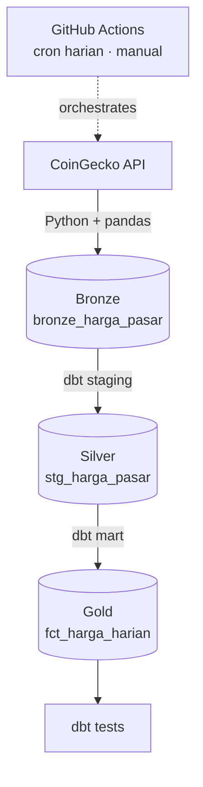

#  COMMODEX — Market Price Medallion Data Engine

[](https://github.com/dimssrmdn01/commodex/actions/workflows/pipeline.yml)


`commodex` adalah pipeline *end-to-end analytics engineering* dengan **Medallion Architecture** (Bronze → Silver → Gold). Pipeline mengambil harga aset pasar dari [CoinGecko API](https://www.coingecko.com/en/api), mentransformasikannya dengan dbt, dan memvalidasinya dengan data quality test yang dijalankan otomatis lewat GitHub Actions.

**Aset yang dilacak:** Bitcoin, Ethereum, Tether, Solana, BNB (harga dalam IDR dan USD).

##  Problem Statement

Data harga dari API publik datang sebagai snapshot mentah: tipe data tidak konsisten, timestamp berupa epoch, dan pemanggilan berulang bisa menghasilkan data ganda. Proyek ini mengubahnya menjadi tabel analitik harian yang bersih dan teruji.

##  Architecture



##  Data Layers

| Layer  | Tipe  | Objek                       | Deskripsi                                                                     |
|--------|-------|-----------------------------|-------------------------------------------------------------------------------|
| Bronze | Table | `public.bronze_harga_pasar` | Snapshot mentah API (append-only) + kolom `ingested_at`                       |
| Silver | View  | `public.stg_harga_pasar`    | Casting numerik, konversi epoch → timestamp, normalisasi `change_24h_pct`, dedup |
| Gold   | Table | `public.fct_harga_harian`   | Per aset per hari: rata-rata harga IDR/USD, perubahan 24 jam maksimum, jumlah datapoint |

##  Data Quality Tests

Tes dbt pada `fct_harga_harian`: `not_null` pada `asset_id`, `date_key`, dan `avg_price_idr`. Tes dijalankan di setiap eksekusi pipeline (`dbt test`).

## 🛠️ Tech Stack

- **Ingestion:** Python 3.11, `requests`, `pandas`, `SQLAlchemy`
- **Storage:** PostgreSQL 15 (Docker Compose lokal, service container di CI)
- **Transformation & Testing:** dbt-core + dbt-postgres
- **CI/CD:** GitHub Actions (cron harian 00:00 UTC dan manual trigger)

##  CI/CD

`.github/workflows/pipeline.yml` menjalankan Postgres sebagai service container, lalu: install dependencies → ingest ke Bronze → `dbt run` → `dbt test`. Database CI bersifat sementara, jadi workflow berfungsi sebagai validasi end-to-end pipeline, bukan penyimpanan histori.

##  Struktur Proyek

```text
commodex/
├── .github/workflows/pipeline.yml   # CI/CD
├── dbt/                             # sources, staging, marts, tests
├── src/ingest.py                    # ingestion ke Bronze
├── docker-compose.yml               # PostgreSQL lokal
├── requirements.txt
└── README.md
```

##  Quick Start

```bash
git clone https://github.com/dimssrmdn01/commodex.git
cd commodex
python -m venv venv
source venv/bin/activate        # Windows: .\venv\Scripts\activate
pip install -r requirements.txt

docker compose up -d            # PostgreSQL lokal (port 5433)

python src/ingest.py            # Bronze
cd dbt
dbt run --profiles-dir .        # Silver & Gold
dbt test --profiles-dir .       # Data quality tests
```

Kredensial database dapat diatur lewat environment variable `DB_USER`, `DB_PASSWORD`, `DB_HOST`, `DB_PORT`, `DB_NAME` (default untuk development lokal).

##  Contoh Query

```sql
SELECT asset_id, date_key, avg_price_usd, max_change_24h_pct, total_datapoints
FROM public.fct_harga_harian
ORDER BY date_key DESC, asset_id;
```

##  Known Limitations

- Database di CI bersifat sementara, sehingga histori harga tidak tersimpan antar-run.
- Ingestion berupa snapshot per eksekusi (batch harian), bukan streaming.

##  Roadmap

- [ ] Database cloud persisten (Neon/Supabase) + GitHub Secrets untuk akumulasi histori
- [ ] Tambah sumber komoditas riil (emas, minyak) agar sesuai nama proyek
- [ ] Dashboard (Metabase/Streamlit) di atas layer Gold
- [ ] dbt docs + lineage graph via GitHub Pages

## 📜 License

MIT License.
